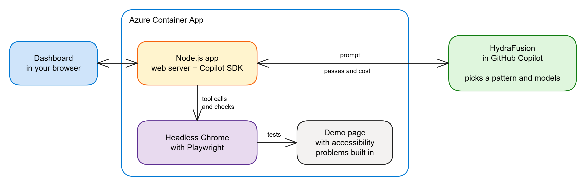
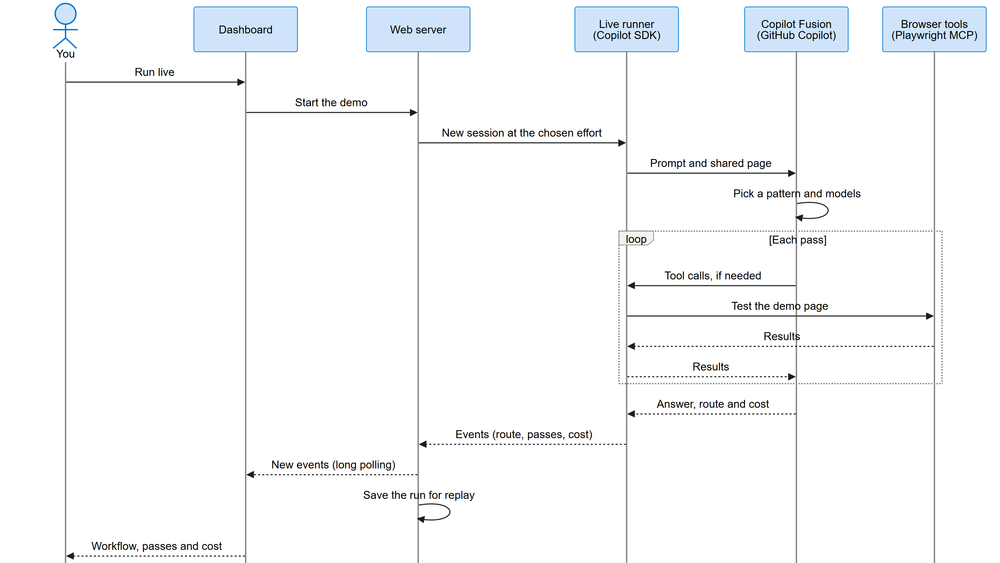

# GitHub Copilot Fusion accessibility workshop

GitHub Copilot Fusion is a generally available model router and orchestrator, not a single model. It combines Project HydraFusion's multi-model orchestration with Copilot's automatic model selection. In this workshop, you'll use it to inspect a page with accessibility problems built in, watch the models work, and compare their results and costs.

The [October 28, 2026 launch announcement](https://github.blog/changelog/2026-10-28-route-and-orchestrate-models-with-github-copilot-fusion/) introduces three effort levels:

| Effort level | Priority |
|---|---|
| Fusion Standard | Versatile models for everyday coding |
| Fusion High | Capable models for challenging tasks and deeper reasoning |
| Fusion Max | The most capable models for demanding tasks and complex reasoning |

Select **Copilot Fusion** in the model picker, then choose an effort level. It is available on all Copilot plans in Visual Studio Code, the GitHub Copilot app, Copilot CLI and JetBrains IDEs. Update your client first. Enterprise and organization model policies still control which models it can use.

**Live demo:** https://aka.ms/hydrafusion  
**Slides:** [GitHub Copilot Fusion and accessibility testing](slides/copilot-fusion-101.pdf)

The live-demo short link and repository URL retain their existing addresses; rebranding the workshop does not rename external resources.

Audience members replay existing recordings without spending AIU. Only the GitHub admin can start live audits or run the fixed checks. Follow the SDK and browser-tool code, and optionally host the workshop on Azure.

1. [Open the app](#1-open-the-app)
2. [Explore a recorded run](#2-explore-a-recorded-run)
3. [Measure the page without AI](#3-measure-the-page-without-ai)
4. [Run an AI-driven audit](#4-run-an-ai-driven-audit)
5. [Follow the SDK and browser tools](#5-follow-the-sdk-and-browser-tools)
6. [Host a five-person workshop on Azure](#6-host-a-five-person-workshop-on-azure)

## 1. Open the app

Use the **live demo** above to join a hosted workshop; no local setup or sign-in is needed for replays. The main page keeps recordings, check descriptions and results together. Its **Tutorials** link opens a short workshop, with screenshots, on Copilot Fusion, live runs and replays, and the browser tools.

### Run your own copy locally

You need:

- Node.js **22.12 or later**.
- Google Chrome for the browser tools and accessibility checks.
- For live runs, a GitHub account with Copilot and model policies that allow Copilot Fusion. Sign in with the Copilot CLI, or set the `COPILOT_GITHUB_TOKEN` environment variable to a token with Copilot access. Do not put the token in source files.

From the repository folder:

```sh
npm install
npm start
```

Open http://127.0.0.1:4173/ and leave the terminal running. The local dashboard is replay-only; use the terminal commands below for new runs and checks on your own machine. Hosted admin sign-in uses Azure's built-in GitHub authentication.

## 2. Explore a recorded run

**Goal:** recognise the three patterns before spending AIU.

1. On the **Single** card, select **Replay reference run**.
2. Watch the workflow, passes, answer and cost appear. Use **Skip to the end** if needed.
3. Repeat with **Critique** and **Cascade**.
4. Expand **Routing, pattern and token details** to inspect the selected route and pass states.
5. Under **Saved runs and costs**, open **Reference run costs** to compare the examples.

Look for these differences:

| Pattern | What happens |
|---|---|
| Single | One solver does the work |
| Critique | A solver drafts, a critic reviews, and the original solver revises if needed |
| Cascade | A solver answers, a judge scores it, and a stronger model repairs it if needed |

Reference recordings may not include every router score or token-level detail. The bundled recordings predate general availability and retain their original SDK identifiers, tier labels and charges. The old Default tier corresponds to Fusion High; it does not mean Fusion Standard. Their models and prices are historical examples, not a promise of what a new run will use.

You can also replay all three in a separate terminal, without spending AIU:

```sh
npm run demo -- all --replay reference
```

## 3. Measure the page without AI

**Goal:** establish a measured baseline for the model's audit.

**Hosted dashboard: admin-only.** Sign in with GitHub using **Admin sign-in** first. Audience members can read the expected results and snippets, but cannot execute the checks.

1. Expand **Preview the demo page** under **Accessibility checks**. The page is intentionally inaccessible.
2. Select **Run the checks**.
3. Compare **Measured now** with **Built into the demo page**.
4. Open **Show the snippet** on a row to inspect the code behind the result.

This button runs **eight prewritten checks directly through Playwright**: contrast, language and landmarks, heading order, keyboard navigation, reflow, motion, accessible names, and an axe-core scan. It **does not call Copilot or spend AIU**.

The runner is in [checks/run-checks.mjs](checks/run-checks.mjs), and the axe-core scan is in [checks/08-axe.js](checks/08-axe.js). To run the same suite from a terminal:

```sh
npm run checks
```

**Expected result:** all eight checks find the problems built into the page. "8 of 8" means the checks detected those problems, **not** that the page passes accessibility requirements.

## 4. Run an AI-driven audit

**Goal:** compare an AI-selected investigation with the fixed checks.

**Hosted dashboard: admin-only.** Only the configured GitHub admin sees **Run live**. Audience members use the replay buttons instead.

**Live runs spend AIU from the Copilot account used by the server.** In a hosted workshop, that is the host's account, not each participant's.

Copilot Fusion bills each model it uses at that model's standard rate. The launch announced a limited-time **30% model-cost discount on paid plans**; consult the announcement for the offer. This app displays SDK-reported usage without adding its own discount or repricing historical recordings.

The cards send these prompts in fresh sessions:

| Demo card | Effort | Prompt |
|---|---|---|
| Single | Fusion High | In one sentence, what does WCAG 1.1.1 require? No tools. |
| Critique | Fusion Max | Audit this page for WCAG 2.2 AA. Don't change any files. List each problem and the rule it breaks. |
| Cascade | Fusion High | quickly test this page with the browser tools |

These effort choices preserve the original demos' routing behavior; they are not a mapping of effort levels to patterns. Fusion Standard is also available in Copilot clients.

1. Try **Run live** on **Single** first to see a short text-only request. It does not audit the page.
2. Run **Cascade** to let the model inspect the demo page with browser tools.
3. Watch the tool calls and passes, then compare the answer with the measured problems from step 3.
4. Try **Critique** for a deeper audit at Max effort. Allow several minutes for a long audit.
5. Compare costs and replay the saved results without starting more model requests.

The card names describe the patterns the prompts tend to get. **Copilot Fusion's router decides the actual pattern**, so always read the workflow shown in the viewer.

The live model chooses its own checks; it does not automatically rerun the eight fixed snippets. Ask whether its findings are backed by measurements, which problems it missed, and whether extra passes improved the answer.

You can stop a live run, replay a recording while it continues, or visit **Tutorials** and return with **Back to demos**. Returning in the same tab resumes that tab's live run.

For the terminal equivalent, the following starts all three demos live and **spends AIU**:

```sh
npm run demo -- all
```

Neither the model's audit nor the fixed checks establishes complete WCAG compliance. Keep manual keyboard and screen-reader testing in your process.

## 5. Follow the SDK and browser tools

**Goal:** understand which part sends prompts, which part makes decisions, and which part performs the browser actions.

### The JavaScript stack

The app uses **plain JavaScript running on Node.js**. No JavaScript framework is needed to call the SDK: there is no React, Next.js or Express.

| Layer | Technology | Code |
|---|---|---|
| Dashboard | HTML, CSS and vanilla JavaScript | [public/app.js](public/app.js) |
| Web server | Node.js 22 and its built-in HTTP server | [src/server.mjs](src/server.mjs) |
| Copilot sessions | The official `@github/copilot-sdk` npm package | [src/live.mjs](src/live.mjs) |
| Browser tools | Playwright MCP controlling Chrome | [src/browser-mcp.mjs](src/browser-mcp.mjs) |



### Trace a live request

1. The dashboard sends `POST /api/live` using `fetch()`.
2. The server checks the limits and calls `runLiveDemo` in the background.
3. The live runner creates a Copilot client and a new session, then sends the prompt. For the browser-based demos, it also attaches the demo page's URL.
4. SDK events report progress, answers, tool calls and usage. The dashboard long-polls `GET /api/live/:id?after=n` to display them as they arrive.
5. The server saves the finished run for replay.

Here is the core SDK call sequence, simplified. The options, handler and timeout come from the live runner:

```javascript
import { CopilotClient } from '@github/copilot-sdk';

const client = new CopilotClient(clientOptions);
await client.start();

try {
  const session = await client.createSession(sessionOptions);
  session.on(onEvent);
  await session.sendAndWait({ prompt: demo.prompt }, RUN_TIMEOUT_MS);
} finally {
  await client.stop();
}
```

The session options select the effort's SDK routing identifier and configure the browser tools, read-only permissions and runtime feature flags. Each live run gets its own session.

### SDK and replay compatibility

The current SDK runtime retains the pre-launch wire identifiers: `auto` for Fusion Standard, `hydrafusion` for Fusion High, and `hydrafusion-max` for Fusion Max. The `HYDRAFUSION`, `HYDRAFUSION_ROLLOUT` and `HYDRAFUSION_PLAN_V2` feature-flag keys are also SDK protocol names, not public product names. Do not mechanically rename these values or the `session.fusion_*` / `assistant.fusion_*` event types. They are centralized in [src/shared/demos.mjs](src/shared/demos.mjs) and [src/live.mjs](src/live.mjs).

Recorded events and original recording titles remain unchanged so their routing, models and billing can still be inspected faithfully. The viewer translates the old Default effort label to Fusion High. Existing tabs migrate their saved live-run pointer to `copilot-fusion.live-run` when resumed.



### How the model tests accessibility

**The SDK doesn't test accessibility itself.** It connects the model to tools through **MCP (Model Context Protocol)**.

The session configuration in [src/live.mjs](src/live.mjs) includes:

```javascript
mcpServers: {
  browser: browserServerConfig(pageUrl, id)
}
```

The model requests a tool, Playwright performs the action in Chrome, and the observations return to the model. The model can request further checks before reporting problems and relevant WCAG rules.

| Model requests | What actually happens |
|---|---|
| `browser_navigate` | Chrome opens the demo page |
| `browser_snapshot` | Returns accessible roles, names and page structure |
| `browser_press_key` | Tests keyboard navigation |
| `browser_evaluate` | Executes JavaScript in the page to measure or inspect it |
| `browser_resize` | Checks behaviour at narrow viewport widths |

The browser runs on the machine hosting the app: your machine locally, or the Container App in Azure. It is not controlling your personal VS Code browser window.

**The SDK and GitHub token stay on the server.** The dashboard never receives the token, and VS Code does not need to be running.

## 6. Host a five-person workshop on Azure

This is the facilitator step. Skip deployment if you're using an existing hosted demo.

### Deploy the app

You need an Azure subscription, the Azure Developer CLI (`azd`) and the GitHub CLI (`gh`), both signed in. The GitHub account needs Copilot with policies that allow Copilot Fusion.

```sh
azd up
```

Open the dashboard URL printed after deployment. The [preprovision hook](infra/hooks/preprovision.mjs) uses your GitHub CLI sign-in for live runs unless you've supplied a fine-grained token.

**Audience access is replay-only.** Live runs, live-run controls and accessibility-check execution are protected by the server, not just hidden buttons. Signing in with another GitHub account does not grant admin access.

### Enable GitHub admin sign-in

Until GitHub sign-in is configured, the dashboard stays replay-only even if a Copilot token is present.

1. [Create a GitHub OAuth app](https://docs.github.com/en/apps/oauth-apps/building-oauth-apps/creating-an-oauth-app). Use the deployed dashboard's HTTPS URL as the homepage, and append `/.auth/login/github/callback` for its authorization callback URL.
2. Set its client ID and secret in the azd environment, not in source files:

   ```sh
   azd env set GITHUB_OAUTH_CLIENT_ID "<client-id>"
   azd env set GITHUB_OAUTH_CLIENT_SECRET "<client-secret>"
   azd provision
   azd deploy
   ```

3. Select **Admin sign-in** on the dashboard. The sole admin defaults to **roryp**, GitHub user ID `6388864`, configured by the `adminGitHubId` parameter in [infra/main.bicep](infra/main.bicep). Access follows the stable ID, not a changeable username.

[Azure Easy Auth](https://learn.microsoft.com/en-us/azure/container-apps/authentication-github) handles login and session cookies. It allows anonymous browsing so audience replays stay public. Only Azure's authenticated GitHub identity is trusted by the API. Do not set `AZURE_AUTH_ENABLED=true` on a server without Azure Easy Auth; local dashboards intentionally do not trust identity headers.

### Where "headless Chrome inside Azure" is configured

Chrome is **not a separate Azure service**. It is an ordinary browser process, without a visible window, inside the same container as Node.js and the Copilot SDK.

1. **Install Chrome in the image.** The [Dockerfile](Dockerfile) includes this installation command, which adds Chrome and its required Linux libraries:

   ```dockerfile
   RUN npx --yes playwright@1.64.0 install --with-deps chrome
   ```

2. **Launch it headless.** `browserServerConfig` in [src/live.mjs](src/live.mjs) defaults to `chrome`, uses an isolated browser profile, and adds:

   ```javascript
   if (!(process.env.FUSION_HEADED ?? process.env.HF_HEADED)) args.push('--headless');
   ```

   `FUSION_HEADED` is not set in the Azure deployment, so live browser tools run headless. Set `FUSION_HEADED=1` locally for a visible browser, or `FUSION_BROWSER=chromium` to use Playwright's installed Chromium. The old `HF_HEADED` and `HF_BROWSER` variables remain compatibility aliases; the new names take precedence. The SDK starts the local [browser-mcp.mjs](src/browser-mcp.mjs) process, which runs Playwright MCP and controls Chrome.

3. **Deploy that image to Azure.** [azure.yaml](azure.yaml) configures the web service as:

   ```yaml
   host: containerapp
   docker:
     path: ./Dockerfile
     remoteBuild: true
   ```

The fixed **Run the checks** path uses the same installed Chrome through Playwright directly; its browser launch is also headless by default.

### Set expectations and limits

The default deployment admits **five independent admin live runs at once**, with a **100-start daily cap**. Audience members cannot start any. Each run has its own Copilot session, isolated browser and output directory, and unique recording ID. Each admin tab follows only its own run, including after a reload.

A sixth start receives a busy message without starting a model request. Replays remain available. Simultaneous requests for the fixed accessibility checks share one in-flight execution instead of launching duplicate browsers.

| Setting | Local default | Azure default |
|---|---|---|
| `LIVE_RUN_CONCURRENCY_LIMIT` | 5 | 5 |
| `LIVE_RUN_DAILY_LIMIT` | 0 (unlimited) | 100 |
| Compute | Your machine | One warm replica, 2 vCPU / 4 GiB |

The Azure limits are the `liveRunConcurrencyLimit` and `liveRunDailyLimit` parameters in [infra/main.bicep](infra/main.bicep).

Keep these constraints in mind:

- **Model capacity:** Copilot Fusion uses GitHub Copilot, not an Azure OpenAI or Foundry model deployment. There is no Azure model TPM setting to raise. Copilot usage allowances and rate limits apply across all users; extra container replicas don't increase them. See [Copilot usage limits](https://docs.github.com/en/copilot/concepts/billing-and-usage/individuals/usage-limits).
- **Spending:** the daily cap limits starts, not tokens or AIU spend. Keep recordings ready as a fallback.
- **Restarts:** limits and live events are in memory, and new recordings are on temporary container storage. Restarting or deploying resets the counter and loses live state and new recordings; bundled recordings remain. Finish active demos before deploying.
- **Scaling out:** keep one replica unless you first move run ownership, events, admission limits and recordings to shared storage and route poll/stop requests to the owning worker.

### Verify before participants join

Run the automated tests locally. They cover anonymous and non-admin replay-only access, plus five admin tabs with a fake model, and spend no AIU; Chrome or Edge must be installed.

```sh
npm test
```

To test your real Azure endpoint, sign in as the admin first. In browser developer tools, copy only the value of the `AppServiceAuthSession` cookie, then set it in your terminal environment (PowerShell example). Treat it as a secret; do not share or commit it.

```powershell
$env:FUSION_ADMIN_SESSION = Get-Clipboard
npm run test:load -- https://your-app.azurecontainerapps.io 5
Remove-Item Env:FUSION_ADMIN_SESSION
```

**This spends AIU and can take several minutes.** Run it when no visitors have active runs, with enough daily allowance and a user count equal to the deployed concurrency limit.

The test exercises five simultaneous admin Critique/Cascade runs, rejects a sixth start without consuming allowance, reloads a tab, replays a recording as an anonymous visitor, and requests all eight accessibility checks as the admin. It requires successful answers, separate replayable recordings, no session or dashboard errors, and a health-response p95 below three seconds.

Results include timings and AIU usage as JSON. The test stops its unfinished runs on failure.

### Clean up after the workshop

Stop a local server with **Ctrl+C**. To remove the resources created for your Azure workshop environment:

```sh
azd down
```

## Further reading

- Use **Tutorials** in the dashboard for the short workshop on Copilot Fusion, live runs and replays, and the browser tools; the page source is [public/tutorials.html](public/tutorials.html). After a dashboard change, run `npm run screenshots` to retake its screenshots in [public/images/tutorial](public/images/tutorial). It replays recordings and runs the fixed checks, so it spends no AIU.
- Edit the architecture diagram in [docs/architecture.excalidraw](docs/architecture.excalidraw) and the request sequence in [docs/sequence.mmd](docs/sequence.mmd). The tutorials page uses a copy of the architecture PNG in [public/images/tutorial](public/images/tutorial), so update both.
- Read [About GitHub Copilot Fusion](https://docs.github.com/en/copilot/concepts/models/copilot-fusion) for current effort levels, availability and policies. Models, prices and routing change, so live results may differ from the recordings.
