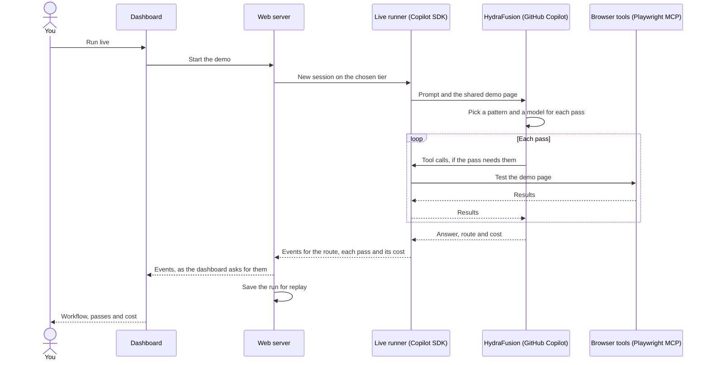

# HydraFusion demos

HydraFusion is a GitHub Copilot model, in research preview, that plans each request and picks a model for each step. This app runs three prompts against a web page with accessibility problems built in, and shows which pattern HydraFusion picked, each step as it runs, and what it cost.

**Slides:** [HydraFusion and Accessibility testing](slides/hydrafusion-101.pdf)

## How it works


To edit the diagram, open `docs/architecture.excalidraw` in Excalidraw.

A live run, step by step:



The events reach the dashboard while the run goes, not only at the end.

## The demos

| Pattern | Tier | Prompt |
|---|---|---|
| Single | Default | In one sentence, what does WCAG 1.1.1 require? No tools. |
| Critique | Max | Audit this page for WCAG 2.2 AA. Don't change any files. List each problem and the rule it breaks. |
| Cascade | Default | quickly test this page with the browser tools |

HydraFusion's router picks the pattern, so a prompt doesn't always get the one next to it. Live runs spend AIU from your Copilot plan. Each demo also comes with a recorded run you can replay for free, for example if a live run takes too long.

## Run it locally

You need Node.js 22.12 or later, Google Chrome, and Copilot access. Sign in with the Copilot CLI, or set `COPILOT_GITHUB_TOKEN` to a GitHub token.

```sh
npm install
npm start                 # open http://127.0.0.1:4173/
npm run demo -- all       # or run the demos in a terminal
```

## Deploy to Azure

You need the Azure Developer CLI and the GitHub CLI, both signed in.

```sh
azd up
```

Live runs use your GitHub CLI sign-in. Anyone with the app's URL can start one, so run `azd down` when you're done.
