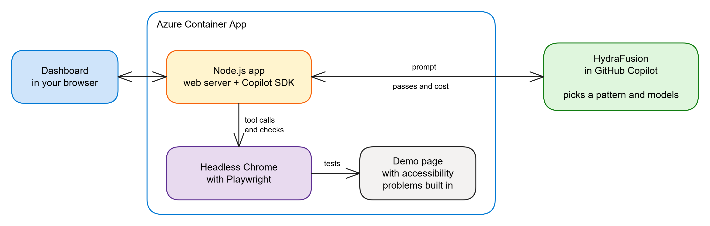
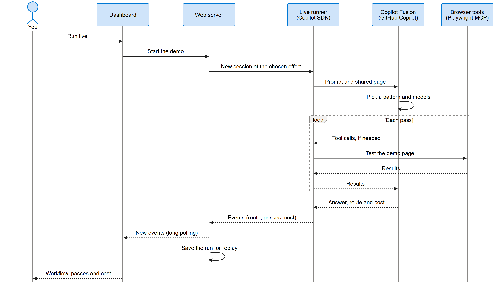

# HydraFusion accessibility workshop

HydraFusion is a GitHub Copilot model, in research preview, that plans a request and picks a model for each step. In this workshop, you'll use it to inspect a page with accessibility problems built in, watch the models work, and compare their results and costs.

**Live demo:** https://aka.ms/hydrafusion  
**Slides:** [HydraFusion and Accessibility testing](slides/hydrafusion-101.pdf)

Start with recordings and fixed checks, which spend no AIU. Then try a live audit, follow the SDK and browser-tool code, and optionally host the workshop on Azure.

1. [Open the app](#1-open-the-app)
2. [Explore a recorded run](#2-explore-a-recorded-run)
3. [Measure the page without AI](#3-measure-the-page-without-ai)
4. [Run an AI-driven audit](#4-run-an-ai-driven-audit)
5. [Follow the SDK and browser tools](#5-follow-the-sdk-and-browser-tools)
6. [Host a five-person workshop on Azure](#6-host-a-five-person-workshop-on-azure)

## 1. Open the app

Use the **live demo** above to join a hosted workshop; no local setup is needed. The main page keeps the interactive demos, checks and results together. Its **Tutorials** link opens the background guide to patterns, billing and accessibility testing.

### Run your own copy locally

You need:

- Node.js **22.12 or later**.
- Google Chrome for the browser tools and accessibility checks.
- For live runs, a GitHub account with Copilot and HydraFusion preview access. Sign in with the Copilot CLI, or set the `COPILOT_GITHUB_TOKEN` environment variable to a token with Copilot access. Do not put the token in source files.

From the repository folder:

```sh
npm install
npm start
```

Open http://127.0.0.1:4173/ and leave the terminal running. Replays and the fixed checks do not need a Copilot session.

## 2. Explore a recorded run

**Goal:** recognise the three patterns before spending AIU.

1. On the **Single** card, select **Replay reference run**.
2. Watch the workflow, passes, answer and cost appear. Use **Skip to the end** if needed.
3. Repeat with **Critique** and **Cascade**.
4. Expand **Routing, pattern and token details** to inspect the selected route and pass states.
5. Under **Saved runs and costs**, open **Reference run costs** to compare the examples.

Look for these differences:

| Pattern | What happens |
|---|---|
| Single | One solver does the work |
| Critique | A solver drafts, a critic reviews, and the original solver revises if needed |
| Cascade | A solver answers, a judge scores it, and a stronger model repairs it if needed |

Reference recordings may not include every router score or token-level detail. Their models and prices are examples, not a promise of what a new run will use.

You can also replay all three in a separate terminal, without spending AIU:

```sh
npm run demo -- all --replay reference
```

## 3. Measure the page without AI

**Goal:** establish a measured baseline for the model's audit.

1. Expand **Preview the demo page** under **Accessibility checks**. The page is intentionally inaccessible.
2. Select **Run the checks**.
3. Compare **Measured now** with **Built into the demo page**.
4. Open **Show the snippet** on a row to inspect the code behind the result.

This button runs **eight prewritten checks directly through Playwright**: contrast, language and landmarks, heading order, keyboard navigation, reflow, motion, accessible names, and an axe-core scan. It **does not call Copilot or spend AIU**.

The runner is in [checks/run-checks.mjs](checks/run-checks.mjs), and the axe-core scan is in [checks/08-axe.js](checks/08-axe.js). To run the same suite from a terminal:

```sh
npm run checks
```

**Expected result:** all eight checks find the problems built into the page. "8 of 8" means the checks detected those problems, **not** that the page passes accessibility requirements.

## 4. Run an AI-driven audit

**Goal:** compare an AI-selected investigation with the fixed checks.

**Live runs spend AIU from the Copilot account used by the server.** In a hosted workshop, that is the host's account, not each participant's.

The cards send these prompts in fresh sessions:

| Demo card | Tier | Prompt |
|---|---|---|
| Single | Default | In one sentence, what does WCAG 1.1.1 require? No tools. |
| Critique | Max | Audit this page for WCAG 2.2 AA. Don't change any files. List each problem and the rule it breaks. |
| Cascade | Default | quickly test this page with the browser tools |

1. Try **Run live** on **Single** first to see a short text-only request. It does not audit the page.
2. Run **Cascade** to let the model inspect the demo page with browser tools.
3. Watch the tool calls and passes, then compare the answer with the measured problems from step 3.
4. Try **Critique** for a deeper audit on the Max tier. Allow several minutes for a long audit.
5. Compare costs and replay the saved results without starting more model requests.

The card names describe the patterns the prompts tend to get. **HydraFusion's router decides the actual pattern**, so always read the workflow shown in the viewer.

The live model chooses its own checks; it does not automatically rerun the eight fixed snippets. Ask whether its findings are backed by measurements, which problems it missed, and whether extra passes improved the answer.

You can stop a live run, replay a recording while it continues, or visit **Tutorials** and return with **Back to demos**. Returning in the same tab resumes that tab's live run.

For the terminal equivalent, the following starts all three demos live and **spends AIU**:

```sh
npm run demo -- all
```

Neither the model's audit nor the fixed checks establishes complete WCAG compliance. Keep manual keyboard and screen-reader testing in your process.

## 5. Follow the SDK and browser tools

**Goal:** understand which part sends prompts, which part makes decisions, and which part performs the browser actions.

### The JavaScript stack

The app uses **plain JavaScript running on Node.js**. No JavaScript framework is needed to call the SDK: there is no React, Next.js or Express.

| Layer | Technology | Code |
|---|---|---|
| Dashboard | HTML, CSS and vanilla JavaScript | [public/app.js](public/app.js) |
| Web server | Node.js 22 and its built-in HTTP server | [src/server.mjs](src/server.mjs) |
| Copilot sessions | The official `@github/copilot-sdk` npm package | [src/live.mjs](src/live.mjs) |
| Browser tools | Playwright MCP controlling Chrome | [src/browser-mcp.mjs](src/browser-mcp.mjs) |



### Trace a live request

1. The dashboard sends `POST /api/live` using `fetch()`.
2. The server checks the limits and calls `runLiveDemo` in the background.
3. The live runner creates a Copilot client and a new session, then sends the prompt. For the browser-based demos, it also attaches the demo page's URL.
4. SDK events report progress, answers, tool calls and usage. The dashboard long-polls `GET /api/live/:id?after=n` to display them as they arrive.
5. The server saves the finished run for replay.

Here is the core SDK call sequence, simplified. The options, handler and timeout come from the live runner:

```javascript
import { CopilotClient } from '@github/copilot-sdk';

const client = new CopilotClient(clientOptions);
await client.start();

try {
  const session = await client.createSession(sessionOptions);
  session.on(onEvent);
  await session.sendAndWait({ prompt: demo.prompt }, RUN_TIMEOUT_MS);
} finally {
  await client.stop();
}
```

The session options select `hydrafusion` or `hydrafusion-max` and configure the browser tools, read-only permissions and preview flags. Each live run gets its own session.



### How the model tests accessibility

**The SDK doesn't test accessibility itself.** It connects the model to tools through **MCP (Model Context Protocol)**.

The session configuration in [src/live.mjs](src/live.mjs) includes:

```javascript
mcpServers: {
  browser: browserServerConfig(pageUrl, id)
}
```

The model requests a tool, Playwright performs the action in Chrome, and the observations return to the model. The model can request further checks before reporting problems and relevant WCAG rules.

| Model requests | What actually happens |
|---|---|
| `browser_navigate` | Chrome opens the demo page |
| `browser_snapshot` | Returns accessible roles, names and page structure |
| `browser_press_key` | Tests keyboard navigation |
| `browser_evaluate` | Executes JavaScript in the page to measure or inspect it |
| `browser_resize` | Checks behaviour at narrow viewport widths |

The browser runs on the machine hosting the app: your machine locally, or the Container App in Azure. It is not controlling your personal VS Code browser window.

**The SDK and GitHub token stay on the server.** The dashboard never receives the token, and VS Code does not need to be running.

## 6. Host a five-person workshop on Azure

This is the facilitator step. Skip deployment if you're using an existing hosted demo.

### Deploy the app

You need an Azure subscription, the Azure Developer CLI (`azd`) and the GitHub CLI (`gh`), both signed in. The GitHub account needs Copilot and HydraFusion access.

```sh
azd up
```

Open the dashboard URL printed after deployment. The [preprovision hook](infra/hooks/preprovision.mjs) uses your GitHub CLI sign-in for live runs unless you've supplied a fine-grained token.

**Anyone with the app's URL can start billable live runs.** Share it with your workshop group, monitor account usage, and remove the deployment when you're finished.

### Where "headless Chrome inside Azure" is configured

Chrome is **not a separate Azure service**. It is an ordinary browser process, without a visible window, inside the same container as Node.js and the Copilot SDK.

1. **Install Chrome in the image.** The [Dockerfile](Dockerfile) includes this installation command, which adds Chrome and its required Linux libraries:

   ```dockerfile
   RUN npx --yes playwright@1.64.0 install --with-deps chrome
   ```

2. **Launch it headless.** `browserServerConfig` in [src/live.mjs](src/live.mjs) defaults to `chrome`, uses an isolated browser profile, and adds:

   ```javascript
   if (!process.env.HF_HEADED) args.push('--headless');
   ```

   `HF_HEADED` is not set in the Azure deployment, so live browser tools run headless. The SDK starts the local [browser-mcp.mjs](src/browser-mcp.mjs) process, which runs Playwright MCP and controls Chrome.

3. **Deploy that image to Azure.** [azure.yaml](azure.yaml) configures the web service as:

   ```yaml
   host: containerapp
   docker:
     path: ./Dockerfile
     remoteBuild: true
   ```

The fixed **Run the checks** path uses the same installed Chrome through Playwright directly; its browser launch is also headless by default.

### Set expectations and limits

The default deployment admits **five independent live runs at once**, with a **100-start daily cap**. Each run has its own Copilot session, isolated browser and output directory, and unique recording ID. Each tab follows only its own run, including after a reload.

A sixth start receives a busy message without starting a model request. Replays remain available. Simultaneous requests for the fixed accessibility checks share one in-flight execution instead of launching duplicate browsers.

| Setting | Local default | Azure default |
|---|---|---|
| `LIVE_RUN_CONCURRENCY_LIMIT` | 5 | 5 |
| `LIVE_RUN_DAILY_LIMIT` | 0 (unlimited) | 100 |
| Compute | Your machine | One warm replica, 2 vCPU / 4 GiB |

The Azure limits are the `liveRunConcurrencyLimit` and `liveRunDailyLimit` parameters in [infra/main.bicep](infra/main.bicep).

Keep these constraints in mind:

- **Model capacity:** HydraFusion uses GitHub Copilot, not an Azure OpenAI or Foundry model deployment. There is no Azure model TPM setting to raise. Copilot usage allowances and rate limits apply across all users; extra container replicas don't increase them. See [Copilot usage limits](https://docs.github.com/en/copilot/concepts/billing-and-usage/individuals/usage-limits).
- **Spending:** the daily cap limits starts, not tokens or AIU spend. Keep recordings ready as a fallback.
- **Restarts:** limits and live events are in memory, and new recordings are on temporary container storage. Restarting or deploying resets the counter and loses live state and new recordings; bundled recordings remain. Finish active demos before deploying.
- **Scaling out:** keep one replica unless you first move run ownership, events, admission limits and recordings to shared storage and route poll/stop requests to the owning worker.

### Verify before participants join

Run the automated tests locally. They include five-user browser tests with a fake model and spend no AIU; Chrome or Edge must be installed.

```sh
npm test
```

Then test your real Azure endpoint:

```sh
npm run test:load -- https://your-app.azurecontainerapps.io 5
```

**This spends AIU and can take several minutes.** Run it when no visitors have active runs, with enough daily allowance and a user count equal to the deployed concurrency limit.

The test exercises five simultaneous Critique/Cascade runs, rejects a sixth start without consuming allowance, reloads a tab, replays a recording, and requests all eight accessibility checks for each user. It requires successful answers, separate replayable recordings, no session or dashboard errors, and a health-response p95 below three seconds.

Results include timings and AIU usage as JSON. The test stops its unfinished runs on failure.

### Clean up after the workshop

Stop a local server with **Ctrl+C**. To remove the resources created for your Azure workshop environment:

```sh
azd down
```

## Further reading

- Use **Tutorials** in the dashboard for the pattern, billing and VS Code walkthroughs; the page source is [public/tutorials.html](public/tutorials.html).
- Edit the architecture diagram in [docs/architecture.excalidraw](docs/architecture.excalidraw) and the request sequence in [docs/sequence.mmd](docs/sequence.mmd).
- HydraFusion is a research preview. Models, prices and routing change, so live results may differ from the recordings.
